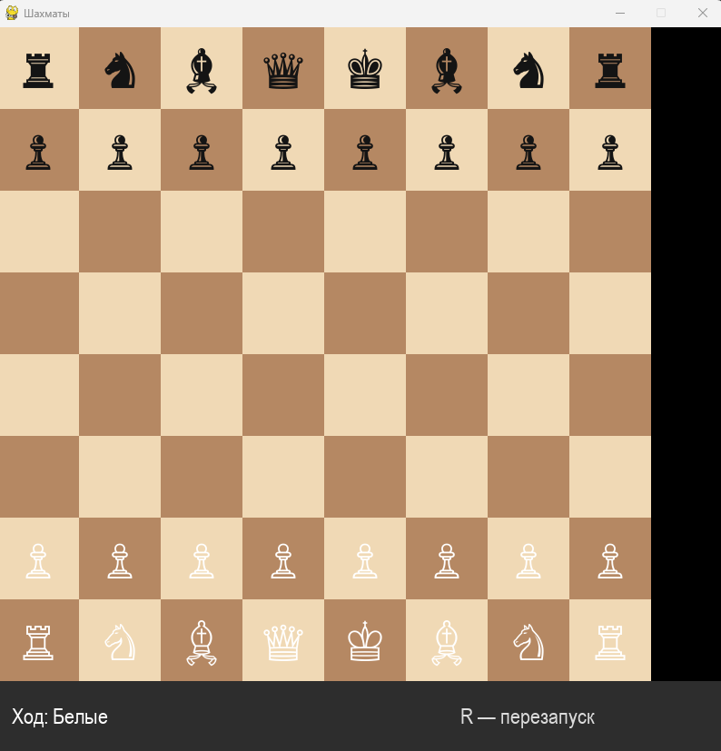

# Шахматы

**Автор:** Кульков Иван Максимович, Люшин Егор Александрович

**Группа:** ПИ25-1

**Дисциплина:** Практикум по программированию

**Вариант:** Шахматы

**Дата сдачи:** 24.11.2026

## Описание проекта

Программа представляет собой графическую шахматную игру для двух игроков на
одном компьютере. Игроки перемещают фигуры мышью, а приложение проверяет
допустимость ходов и отображает шах, мат и пат.

## Функциональные возможности

### Основной функционал

- Отрисовка шахматной доски и начальной расстановки фигур.
- Выбор своей фигуры и подсветка доступных ходов.
- Перемещение фигур мышью с проверкой допустимости хода.
- Запрет ходов, оставляющих собственного короля под шахом.
- Смена активного игрока после успешного хода.
- Определение шаха, мата и пата.
- Перезапуск партии клавишей `R`.

### Дополнительный функционал

- Рокировка с проверкой условий безопасности короля.
- Взятие на проходе.
- Превращение пешки в ферзя, ладью, слона или коня.
- Подсветка последнего хода.
- Отображение количества ходов и списка взятых фигур.
- Вывод сообщения о шахе и завершении партии.

## Требования к системе

- **Python:** 3.13.
- **Операционная система:** Windows, macOS или Linux.
- **Библиотеки:** Pygame 2.6.1 (указана в `requirements.txt`).

Для этой версии Pygame используйте Python 3.13: установленный в репозитории
виртуальный каталог `venv/` может быть создан для другой версии Python или
другой операционной системы и не должен использоваться без переустановки
зависимостей.

## Установка и запуск

Выполняйте команды из корневой папки проекта.

### 1. Клонирование репозитория

```bash
git clone https://github.com/vantuzov/simple_games.git
cd simple_games
```

### 2. Создание виртуального окружения

На Windows создайте окружение именно Python 3.13:

```powershell
py -3.13 -m venv venv
```

На macOS/Linux:

```bash
python3.13 -m venv venv
```

Если команда не найдена, сначала установите Python 3.13 и повторите этот шаг.

### 3. Активация окружения

Windows PowerShell:

```powershell
.\venv\Scripts\Activate.ps1
```

Windows Command Prompt:

```bat
venv\Scripts\activate.bat
```

macOS/Linux:

```bash
source venv/bin/activate
```

### 4. Установка зависимостей

```bash
python -m pip install --upgrade pip
python -m pip install --force-reinstall -r requirements.txt
```

`--force-reinstall` нужен, если в уже существующем `venv/` остались метаданные
Pygame, но отсутствует его бинарный модуль. Если вы создаёте чистое окружение,
можно использовать обычную команду `python -m pip install -r requirements.txt`.

### 5. Запуск программы

Оставаясь в корневой папке проекта и с активным виртуальным окружением,
выполните:

```bash
python main.py
```

В Windows можно запустить без активации окружения:

```powershell
.\venv\Scripts\python.exe main.py
```

Если окно не появляется, проверьте, что команда `python --version` показывает
Python 3.13, а `python -m pip show pygame` показывает Pygame 2.6.1.

## Пример использования

1. Запустите `python main.py`.
2. Щёлкните мышью по своей фигуре: доступные клетки будут подсвечены.
3. Щёлкните по подсвеченной клетке, чтобы сделать ход. Например, белая пешка
   с начальной клетки e2 может пойти на e4.
4. Нажмите `R`, чтобы начать новую партию.

## Управление

- **Левая кнопка мыши:** выбрать свою фигуру, затем выбрать подсвеченную клетку.
- **Клавиша `R`:** перезапустить партию.
- **После превращения пешки:** нажать кнопку с названием желаемой фигуры.

## Структура проекта

```text
simple_games/
├── README.md
├── requirements.txt
├── main.py
├── src/
│   ├── __init__.py
│   ├── app.py
│   ├── models/
│   │   ├── __init__.py
│   │   ├── board.py
│   │   └── piece.py
│   ├── renderers/
│   │   ├── __init__.py
│   │   └── renderer.py
│   └── widgets/
│       └── __init__.py
└── tests/
    ├── __init__.py
    └── test_board.py
```

### Назначение модулей

- `main.py` — точка входа в программу.
- `src/app.py` — окно Pygame, игровой цикл и обработка действий пользователя.
- `src/models/board.py` — доска, правила ходов и состояние партии.
- `src/models/piece.py` — модель шахматной фигуры.
- `src/renderers/renderer.py` — отрисовка доски, фигур и подсказок.
- `src/widgets/` — пакет для виджетов интерфейса.
- `tests/test_board.py` — тесты шахматной модели.
- `requirements.txt` — версии внешних библиотек проекта.
- `venv/` — виртуальное окружение, включённое в репозиторий по требованиям
  проекта; для своей системы его следует настроить по инструкции выше.

Модульная структура отделяет правила игры от графической отрисовки и
обработки ввода. Благодаря этому модель можно тестировать отдельно от окна
Pygame, а интерфейс и правила можно изменять независимо.

## Демонстрация работы программы

